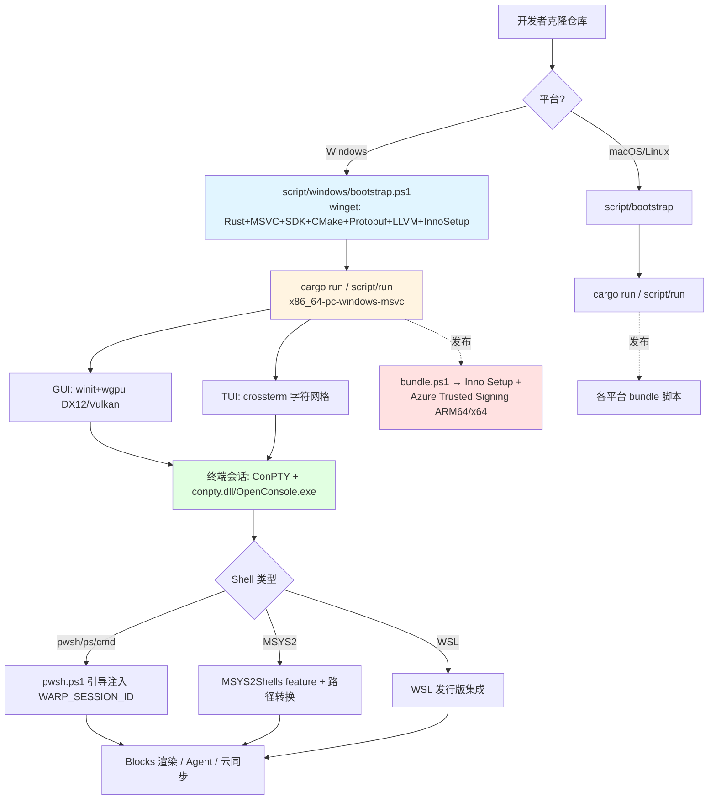

# Warp - Windows 兼容性分析

> 生成时间: 2026-11-17
> 数据来源: 自动化扫描（out/05-Windows兼容性检查.md）+ 源码/脚本深度核查（cfg 守卫统计、ConPTY 后端、构建链、CI 矩阵）

## 总体评估

| 指标 | 结果 |
|------|------|
| 总体评级 | ✅ 完全兼容（一等公民平台） |
| 高危问题 | 0 |
| 中危问题 | 3（开发环境构建复杂、个别功能缺口、MAX_PATH 敏感） |
| 低危问题 | 3（clippy 全特性不可用、Docker 开发环境仅 Linux、Win10 圆角） |
| 已正确适配项 | 15+（见第 7 节） |

**结论**：Windows 是 Warp 的一等支持平台——拥有专属 bootstrap/打包工具链、完整的 ConPTY 终端后端（含 MSYS2/WSL/PowerShell shell 发现）、wgpu DX12/Vulkan 渲染、注册表集成（主题/登录项/深链接）、Inno Setup 安装器 + Azure Trusted Signing 签名、崩溃上报，以及覆盖测试/lint/发布检查的 Windows CI。剩余缺口都很窄（shell 替换、Docker 沙箱 shell 等）。

---

## 1. 构建系统兼容性

### 1.1 开发环境搭建（script/windows/）

| 脚本 | 作用 | 说明 |
|------|------|------|
| `script/windows/bootstrap.ps1` | 一键环境准备 | 硬性要求 **Git for Windows**（缺失即报错；同时提供 build 脚本用的 `patch.exe`/`bash.exe`），随后经 winget 安装全部依赖 |
| `script/windows/install_build_deps.ps1` | 构建依赖安装 | 薄封装，经 Git Bash 调用 Unix 侧 `script/install_rust` 与 `script/install_cargo_build_deps` |
| `script/windows/bundle.ps1` | 打包发布 | 构建 x64/ARM64（ARM64 主机经 `PROCESSOR_ARCHITEW6432` 探测），跑 ISCC 编译 Inno Setup 安装器 |
| `script/windows/build_inno_sign_tool_command.ps1` | 签名 | Azure Trusted Signing（`Azure.CodeSigning.Dlib.dll` + signtool /fd SHA256 + 微软时间戳）注入 Inno Setup |
| `script/windows/prepare_bundled_resources.ps1` | 资源准备 | 打包前的捆绑资源整理 |
| `script/windows/README.md` | 文档 | Inno Setup 编译（`iscc windows-installer.iss`）、`/D` 预处理器覆盖、ImageMagick 生成 `.ico` |

**bootstrap.ps1 自动安装的依赖**：Rust（rustup）、VS Build Tools 2022（`VC.Tools.x86x64` + `Windows11SDK.22621`，MSVC 目标 `x86_64-pc-windows-msvc` 经 vswhere 校验）、jq（wasm-bindgen 版本解析）、CMake（sentry-contrib-native）、Protobuf（prost）、LLVM（bindgen 的 libclang.dll，设 LIBCLANG_PATH）、InnoSetup、gcloud CLI。

**无 WebView2 依赖**：GUI 是纯 Rust 自研栈（fork 的 winit + wgpu + warpui），不是 webview 壳。跨平台入口 `script/run` 在 Windows（MSYS/Git Bash 环境 `MINGW64_NT`/`MSYS_NT`）直接走 `cargo run --bin warp-oss --features gui`。

### 1.2 构建工具链

| 工具 | Windows 支持 | 说明 |
|------|-------------|------|
| Rust / Cargo（1.92.0，MSVC 目标） | ✅ | rust-toolchain.toml 固定版本 |
| wgpu 30（DX12/Vulkan） | ✅ | 根 Cargo.toml 显式启用 `dx12`/`vulkan`；DX12 走随包 DXC 编译器 DLL |
| embed-resource（.rc 资源） | ✅ | `app/Cargo.toml` `cfg(windows)` build-dep；`app/build.rs` 生成 resource.rc 并经 `cc::windows_registry::find_tool` 定位 cl.exe |
| Inno Setup（安装器） | ✅ | app 与 TUI 两条安装器（windows-installer.iss / tui-installer.iss） |
| Docker 开发容器 | ❌ 仅 Linux | `docker/linux-dev`（debian:sid）、`docker/agent-dev`（ubuntu:24.04）为 Linux 专属 |

## 2. 源代码兼容性

### 2.1 平台守卫统计

- 全仓库 `cfg(windows)` / `cfg(target_os = "windows")` 共 **392 处**（app/ + crates/；含 specs/配置共 421 处）。
- 按文件数分布：`app/src` 72、`crates/warpui` 10、`crates/warp_tui` 7、`crates/warp_terminal` 7、`warp_util`/`warp_completer`/`command`/`ai` 各 5、`repo_metadata` 4。
- 关键文件：`app/src/lib.rs`（9 处）、`crates/command/src/blocking.rs`（9）、`crates/warp_terminal/src/local_tty/spawner.rs`（10）、`app/src/server/telemetry/events.rs`（23）。

### 2.2 平台代码组织模式

没有集中的 `app/src/windows/` 目录；Windows 代码以 `windows.rs` 兄弟模块形式与各平台并置：

| 模块 | 职责 |
|------|------|
| `app/src/platform/windows.rs` | 平台层入口 |
| `app/src/antivirus/windows.rs` | Security Center / Defender 检测 |
| `app/src/autoupdate/windows.rs` | 自动更新 |
| `app/src/login_item/windows.rs` | 开机自启（HKCU Run 键） |
| `app/src/app_services/windows/registry.rs` | 深链接 URI scheme 注册（`HKCU\Software\Classes`） |
| `app/src/util/file/external_editor/windows.rs` | 外部编辑器探测 |
| `app/src/util/vm_detection.rs` | winreg 虚拟机检测 |
| `app/src/terminal/wsl/` | WSL 发行版集成 |
| `app/src/terminal/audible_bell/windows.rs` | Win32 MessageBeep 响铃 |
| `crates/warpui/src/windowing/winit/windows/` | 剪贴板、网络、系统主题（AppsUseLightTheme）、标题栏按钮、窗口属性 |
| `crates/warpui/src/windowing/winit/notifications/windows.rs` | Toast 通知（tauri-winrt-notification + AppUserModelID） |

Linux 专属依赖（x11rb、zbus、freedesktop-desktop-entry）正确守卫在 `cfg(any(linux, freebsd))`；macOS objc/cocoa 限定在 `crates/warpui/src/platform/mac/objc/`。

### 2.3 终端后端：ConPTY

`crates/warp_terminal/src/local_tty/windows/`：

- `conpty_api.rs` — 经 `LoadLibraryW`/`GetProcAddress` 动态加载 `conpty.dll`（Create/Resize/Close/ShowHide/ReleasePsuedoConsole）
- `proc_thread_attribute_list.rs` — `PROC_THREAD_ATTRIBUTE_PSEUDOCONSOLE` 子进程属性
- `pipes.rs` / `child.rs` / `environment.rs` — 管道、子进程、环境
- `app/build.rs` 将 `conpty.dll`、`OpenConsole.exe`（按架构目录）与 DXC 编译器 DLL 复制到 target 目录

**Shell 发现与派生**（`app/src/terminal/available_shells.rs`）：支持 `Config::Wsl`、`Config::MSYS2(LocalConfig)`、`Config::KnownLocal`（pwsh / powershell.exe / cmd），pwsh 7 / PowerShell 5 安装路径探测在 `crates/warp_util::path::windows`。MSYS2 由 `msys2_shells` 编译 feature → `FeatureFlag::MSYS2Shells`（`app/src/features.rs:182`）控制；路径转换助手（`is_msys2_path`、`convert_msys2_to_windows_native_path`）在 `crates/warp_terminal/src/shell/mod.rs`。

### 2.4 显式不支持项（Unix 专用 API → Windows 现状）

| 功能 | 位置 | Windows 处理 |
|------|------|--------------|
| shell 替换（set-shell） | `app/src/terminal/local_tty/terminal_manager.rs:695` | 明确不支持 |
| Docker 沙箱 shell | `crates/warp_terminal/src/local_tty/windows/mod.rs:217` | 明确不支持 |
| kitty 图片协议 file/shm 通道 | `crates/warp_terminal/src/model/kitty.rs` | UnsupportedPlatform 错误 |
| 代码库索引（full_source_code_embedding） | `crates/ai/src/index/.../mod.rs:36` | UnsupportedPlatform 错误 |
| quake 窗口可见性 | `app/src/root_view.rs:784` | 有注意事项 |
| 每窗口 computer_use 定向 | `crates/computer_use/src/windows/mod.rs:175` | 不支持 |
| Win10 窗口圆角 | `crates/warpui/src/windowing/winit/window.rs:1490` | 美学降级 |

## 3. 文件系统兼容性

### 3.1 路径处理

| 问题 | 证据 | 处理方式 |
|------|------|----------|
| MAX_PATH 255 字符限制 | 根 `Cargo.toml:492-527` | 专门设立短别名 profile `rlto`/`rltoda`/`rcli`/`rclida`（注释明确说明 Windows 路径长度是设立原因） |
| UNC 路径规范化 | `dunce` 为 workspace 依赖 | **44 个文件 133 处使用**（最密集：`crates/ai/src/index/full_source_code_embedding`、`crates/repo_metadata`） |
| MSYS2 ↔ Windows 路径 | `crates/warp_terminal/src/shell/mod.rs` | 显式转换函数 |
| WSL ↔ Windows 宿主路径 | `app/src/terminal/writeable_pty/bootstrap_file/windows.rs` | `convert_wsl_to_windows_host_path` |

### 3.2 引导脚本文件锁

`app/src/terminal/writeable_pty/bootstrap_file/windows.rs` 处理临时引导文件在 Windows 上的文件占用问题。

## 4. Shell 和脚本兼容性

### 4.1 捆绑的 shell 引导脚本（app/assets/bundled/bootstrap/）

| .sh（bash/zsh/fish） | .ps1 对应 | 说明 |
|----------------------|-----------|------|
| bash.sh / zsh.sh / fish.sh + *_init_shell.sh | `pwsh.ps1`（约 1100 行）+ `pwsh_init_shell.ps1` | Windows shell 集成基于 PowerShell：注入 `WARP_BOOTSTRAPPED`、`WARP_HONOR_PS1`、`WARP_INITIAL_WORKING_DIR`、`WARP_PATH_APPEND`、prompt chips；init 脚本经 `@@WARP_SESSION_ID@@` 模板化输出 InitShell 钩子 |

### 4.2 仓库脚本

`script/run`、`script/run-tui` 等 Unix 入口脚本要求 **Git Bash** 运行（Windows 开发因此硬性依赖 Git for Windows）；纯 Windows 流程走 `script/windows/*.ps1`。仓库根的 `PSScriptAnalyzerCustomRules.psm1` 表明 PowerShell 脚本本身也有 lint 规则。

## 5. 测试和 CI/CD 兼容性

### 5.1 CI（.github/workflows/）

| 工作流 | Windows 支持 | 说明 |
|--------|-------------|------|
| `ci.yml` — tests | ✅ | 矩阵含 `os: windows`（windows-latest-large） |
| `ci.yml` — lints | ✅ | 格式化 + clippy；Windows 上刻意不用 `--all-features`（pprof 编译不过，ci.yml:663-665） |
| ci.yml — release-check | ✅ | `./script/bundle --check-only` 发布级编译检查 |
| `create_release.yml` | ✅ | `build_windows`、`build_windows_tui_binaries`（x64 + ARM64）、`release_windows_tui` |
| changelog/label/triage 等辅助工作流 | — | 仅 Linux runner，与 Windows 无关 |

`.config/nextest.toml` 含 Windows 专属的 flaky 测试重试覆盖（update_manager）。`crates/integration`（GUI 集成测试框架）与 TUI render-to-lines 单测均在 Windows CI 上运行。

### 5.2 打包产物校验

`bundle.ps1` 对 TUI/CLI payload 校验必须存在 `conpty.dll`、`OpenConsole.exe`、`vcruntime140*.dll`、`msvcp140.dll`（来自 `app/assets/windows/{arch}`），`-REQUIRE_SIGNATURES` 下做 Authenticode 签名校验（Get-AuthenticodeSignature）。

## 6. 依赖兼容性

| 依赖 | 类别 | Windows 支持 |
|------|------|-------------|
| `windows` 0.62（Win32/Wdk 大量 feature） | 原生 API | ✅ 终端/线程/控制台/注册表等 |
| `winreg` / `windows-registry` / `windows-result` | 注册表 | ✅（登录项、主题、编辑器探测、VM 检测、URI scheme、WSL 模型、注册表偏好存储） |
| wgpu（dx12/vulkan） | GPU | ✅ |
| crash-handler + minidumper | 崩溃收集 | ✅（`cfg(any(linux, freebsd, windows))` 启用；build.rs cfg_alias `linux_or_windows` 启用崩溃恢复） |
| voice_input（cpal/WASAPI） | 语音 | ✅ 跨平台可用，Windows TUI bundle 默认启用 |
| Sentry / opentelemetry | 遥测 | ✅（含 Windows 事件特化，telemetry/events.rs） |
| npx（MCP server 运行） | 外部运行时 | ⚠ 用户需自行安装 Node（`node_runtime` crate 有 Windows 路径）；仓库内 npx 引用仅出现于测试 fixture |
| x11rb / zbus / freedesktop-desktop-entry | Linux 桌面 | 正确 cfg 守卫，不参与 Windows 构建 |

## 7. 已正确处理的适配

| 适配项 | 位置 | 处理方式 |
|--------|------|----------|
| ConPTY 终端后端 | `crates/warp_terminal/src/local_tty/windows/conpty_api.rs` | 动态加载 conpty.dll，含 OpenConsole.exe 随包 |
| MSYS2 shell 支持 | `warp_terminal/src/shell/mod.rs` + feature flag | 路径双向转换 + 启动参数构建 |
| WSL 集成 | `app/src/terminal/wsl/` | 发行版模型 + 路径转换 |
| PowerShell 引导集成 | `app/assets/bundled/bootstrap/pwsh*.ps1` | 与 bash/zsh/fish 对等的会话钩子 |
| DX12/Vulkan 渲染 | 根 Cargo.toml wgpu features | 随包 DXC DLL |
| 注册表三用 | login_item / registry.rs / warpui registry.rs | 自启、深链接、系统主题跟随 |
| Toast 通知 | `warpui/.../notifications/windows.rs` | winrt-notification + AppUserModelID |
| Defender 检测 | `app/src/antivirus/windows.rs` | Security Center API |
| MAX_PATH | 短 profile 别名 | rlto/rcli 系列 |
| UNC 路径 | dunce 133 处 | 广泛使用 |
| 安装器与签名 | bundle.ps1 + Inno Setup | ARM64 支持 + Azure Trusted Signing |
| 崩溃恢复 | crash-handler/minidumper | Windows 启用 |
| CI 全覆盖 | ci.yml / create_release.yml | 测试/lint/发布检查/安装包构建 |

## 8. 修复建议

### 8.1 必须修复 (HIGH)

无。当前代码库 Windows 构建与运行链路完整。

### 8.2 建议修复 (MEDIUM)

1. **开发环境复杂度**：Windows 首次搭建需 Git Bash + winget 全套依赖（CMake/Protobuf/LLVM/InnoSetup…），文档主要在 macOS 视角（CONTRIBUTING.md 无 Windows 专属章节）。建议在 README/CONTRIBUTING 增补 Windows 快速上手小节（现散落在 script/windows/README.md）。
2. **代码库索引平台缺口**：`full_source_code_embedding` 在 Windows 返回 UnsupportedPlatform——Agent Mode 的代码库语义索引能力在 Windows 缺位，值得排期补齐。
3. **clippy 全特性盲区**：Windows CI 因 pprof 无法 `--all-features` lint，部分 feature 组合仅在其它平台检查。

### 8.3 可选改进 (LOW)

1. Win10 圆角窗口美学降级（Win11 已好）。
2. Docker 化开发环境（linux-dev 容器）无 Windows 对应物——可文档说明用 WSL2 + linux-dev 替代。
3. kitty 图片协议 file/shm 通道在 Windows 无实现（GPU 渲染路径已有图片能力，影响有限）。

## 9. 兼容性流程图

