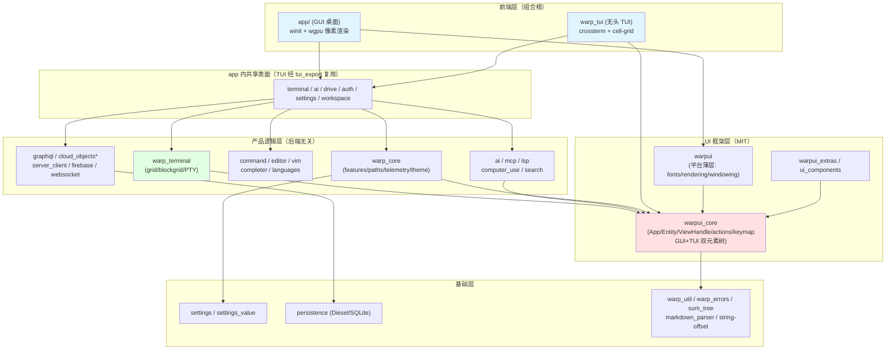

# Warp - 架构分析

> 生成时间: 2026-11-17
> 数据来源: 自动化扫描（out/01~03）+ Cargo 依赖图核查 + lib.rs/关键类型源码验证

## 1. 项目概览

### 1.1 项目信息

| 项目 | 内容 |
|------|------|
| 名称 | Warp（warpdotdev/warp） |
| 语言 | Rust（edition 2024，工具链 1.92.0） |
| 类型 | 智能体开发环境 / 终端模拟器（GUI 桌面应用 + 无头 TUI 双前端） |
| 描述 | 源自终端的 agentic 开发环境：内置编码智能体 + 可接入第三方 CLI 智能体（Claude Code、Codex、Gemini CLI） |
| 许可证 | AGPL-3.0（应用与大部分 crate）；MIT（UI 框架 `warpui_core`、`warpui`） |
| 规模 | 工作空间 79 个 crate（`crates/*` 78 + `app`）+ 2 个外部 git crate；4267 个 Rust 文件，约 186 万行；Cargo.lock 共 1577 个包 |

### 1.2 顶层目录结构

```
warp/
├── app/                     # GUI 桌面应用（组合根：~100 个顶层模块）
│   ├── src/bin/             # 每渠道一个二进制（oss/local/stable/dev/preview/integration）
│   ├── assets/bundled/      # shell 引导脚本（bash/zsh/fish .sh + pwsh .ps1）
│   └── channels/            # 渠道图标/配置
├── crates/                  # 78 个工作空间 crate（见 §2 分层）
├── script/                  # 跨平台入口（run/run-tui/bootstrap/presubmit + windows/ macos/ linux/）
├── resources/bundled/       # 捆绑 skills 等运行时资源
├── specs/                   # 功能规格（product.md / tech.md，按 GH issue 编号）
├── .github/workflows/       # CI（ci.yml 三平台矩阵）
├── docker/                  # Linux 开发容器
└──Cargo.toml / deny.toml / diesel.toml / rust-toolchain.toml
```

### 1.3 文件类型分布（自动化扫描）

| 类型 | 数量 | 说明 |
|------|------|------|
| Rust | 4267 | 主体 |
| C/C++/Obj-C | 13 | `crates/warpui/src`、`app/src` 平台胶水（clang-format 管辖） |
| Python | 38 | 主要为捆绑 skill 的辅助脚本与 CI 工具 |
| JavaScript/TypeScript | 14 | GraphQL 客户端 schema 生成物等 |
| WGSL | 3 | GPU 渲染着色器（wgslfmt 管辖） |

## 2. 架构设计

### 2.1 架构模式

**双前端单体工作空间（two-front-end monorepo）+ 严格分层 + Entity-Handle UI 内核**：

1. **一套核心、两个前端**：GUI（`app/`，winit+wgpu 像素/GPU 渲染）与 TUI（`crates/warp_tui`，crossterm + cell-grid 字符渲染）共享 `warpui_core`/`warp_core` 的 Entity/Model/View、Action、Appearance、FeatureFlag、遥测等。`warpui_core` 内部同时维护 GUI 元素树与 TUI 元素库（`src/elements/tui`，`tui` feature）。
2. **组合根模式**：`app` 与 `warp_tui` 是平级的两个 composition root，各自把全栈装配成二进制；`app` 不依赖 `warp_tui`，反之亦然。两者共用"每渠道一个二进制"的约定（oss/local/stable/dev/preview）。
3. **Entity-Component-Handle**（GPUI/Zed 谱系）：全局 `App` 持有全部 entity，视图间以 `ViewHandle<T>`/`ModelHandle<T>` 互相引用，`AppContext`/`ViewContext`/`ModelContext` 提供受控访问。
4. **产品逻辑后端无关**：终端核心、AI 引擎依赖 `warpui_core`（内核）而非 `warpui`（平台后端），也不依赖任何云 crate——保证可在 GUI、TUI、乃至 WASM 目标上复用。

### 2.2 核心模块（按层）

**A. UI 框架层（MIT 许可）**

| 模块 | 职责 | 关键文件 |
|------|------|----------|
| `warpui_core` | UI 内核：entity/context 系统、actions、keymap、GUI+TUI 双元素树、文本布局、字体、scene、渲染抽象 | `crates/warpui_core/src/core/{app,entity,model,view}`、`elements/tui/mod.rs` |
| `warpui` | 平台薄层（browser/fonts/platform/rendering/windowing），`pub use warpui_core::*` 统一出口 | `crates/warpui/src/lib.rs:8` |
| `warpui_extras` | 补充组件 | - |
| `ui_components` | Warp 专属共享组件（唯一同时依赖 `warp_core`+`warpui` 的框架族成员） | - |

**B. 前端层（组合根）**

| 模块 | 职责 | 关键文件 |
|------|------|----------|
| `app`（GUI） | 桌面应用全部表面：终端/AI/云同步/认证/设置/工作区；`pub mod tui_export`（lib.rs:88）是 TUI 复用的公共面 | `app/src/lib.rs`、`src/bin/*.rs` |
| `warp_tui` | "Warp Agent CLI" 无头前端，78+ 模块（root_view/session/editor_view/agent_block/cloud_run/handoff），渠道二进制镜像 GUI 布局 | `crates/warp_tui/src/lib.rs` |

**C. 终端核心层**

| 模块 | 职责 |
|------|------|
| `warp_terminal` | 终端模拟模型/运行时：`model/`（grid、blockgrid、ansi、escape_sequences、kitty、iterm_image）、`local_tty`（ConPTY/PTY）、`writeable_pty`、`shell`、`runtime`、`shared_session`、`event_listener`、`bootstrap`。**不依赖 `warpui`，不依赖云 crate** |
| `command` | 进程接口（确保以正确 env/目录派生命令），async/blocking + unix/windows/wsl 分裂 |
| `editor`（warp_editor） | 文本编辑（content/decoration/model/multiline/render/search/selection） |
| `vim`、`warp_completer`、`input_classifier`、`syntax_tree`、`languages`、`sum_tree`、`string-offset`、`markdown_parser`、`ipynb_parser`、`regex_dfas`、`fuzzy_match` | vim 状态机 / 补全引擎 / 输入分类 / 语法树 / 多语言定义 / 摘要树 / 偏移文本类型 / Markdown 解析 / notebook 解析 / 正则 DFA / 模糊匹配 |

**D. AI / 智能体层**

| 模块 | 职责 |
|------|------|
| `ai` | 智能体引擎：agent、llm_provider、llm_id、index（代码库索引）、project_context、skills、workspace、document、hooks、api_keys、diff_validation |
| `ai_types` | 纯净轻依赖的 AI 模型类型 |
| `mcp` | MCP 客户端（runtime/sse_transport/oauth/tool_call） |
| 其它 | `computer_use`、`natural_language_detection`、`lsp`、`warp_search_core`（搜索抽象）、`warp_ripgrep`、`warp_multi_agent_client`、`node_runtime`、`warp_harness_usage` |

**E. 云 / 服务层**

| 模块 | 职责 |
|------|------|
| `graphql`（warp_graphql） | cynic 3 GraphQL 客户端，`api/` 按域组织查询模块（ai/billing/folder/mcp_gallery/...） |
| `warp_graphql_schema` | 生成的 schema 容器（lib.rs 仅一个 `#[cynic::schema]` 标记） |
| 云对象族 | `cloud_objects`（模型无关底层：auth/drive/ids/Revision/SyncStatus）→ `cloud_object_models`（具体模型：workflow/notebook/preference/env_vars/mcp/...）→ `cloud_object_client`（服务端同步）→ `cloud_object_persistence`（共享 SQLite 持久化） |
| 网络与服务 | `warp_server_client`、`warp_server_auth`、`firebase`、`remote_server`、`local_control`、`websocket`（native+wasm）、`http_client`、`http_server`、`preview_proxy`、`ipc`、`jsonrpc`、`field_mask` |

**F. 应用基础设施层**

| 模块 | 职责 |
|------|------|
| `warp_core` | warpui_core 与应用之间的平台/应用核心：app_id、channel、cli_agent_protocol、context_flag、execution_mode、features、paths、platform、session_id、sync_queue、telemetry、theme/appearance、user_preferences |
| `warp_features` | `FeatureFlag` 枚举 + AtomicBool 表 + 渠道分组（DEBUG/LOCAL/DOGFOOD/PREVIEW/RELEASE/RUNTIME） |
| `settings`/`settings_value`(+derive) | 设置系统（manager/registration/schema 生成） |
| `persistence` | Diesel + SQLite（60+ 迁移，2021-10 起至今：windows/tabs/panes/blocks/notebooks/users/folders/...） |
| 资产与渠道 | `warp_files`、`warp_assets`、`asset_cache`、`asset_macro`、`warp_channel_config`、`channel_versions`、`build_cache` |
| 其它 | `warp_logging`、`warp_errors`、`warp_util`、`onboarding`、`watcher`、`virtual-fs`、`secret_redaction`、`repo_metadata`、`warp_managed_secrets`(+wasm)、`prevent_sleep`、`voice_input`、`warp_cli`、`simple_logger`、`app-installation-detection`、`isolation_platform`、`handlebars`（vendored）、`integration`（GUI 集成测试框架）、`serve-wasm` |

### 2.3 架构图



### 2.4 关键设计模式（源码证据）

| 模式 | 位置 | 要点 |
|------|------|------|
| Entity-Handle | `crates/warpui_core/src/core/entity.rs:14-52`、`core/app.rs:76,600` | `EntityId` 全局原子分配；`App(Rc<RefCell<AppContext>>)`；`ViewHandle`/`ModelHandle`；`ModelContext`/`ViewContext` |
| Actions 系统 | `crates/warpui_core/src/core/action.rs:23-30`、`core/app.rs:1589` | 空白实现使任何 `Any+Debug+Send+Sync` 类型皆可为 action；dispatch 沿 responder chain 逆序派发；`Keymap` 绑键 |
| TuiElement | `crates/warpui_core/src/elements/tui/mod.rs:297` | layout/after_layout/render/present/dispatch_event 镜像 GUI `Element` 生命周期；经 `TuiPaintSurface` 画入 cell-grid buffer；旁边约 40 个元素实现（flex/stack/scrollable/viewported_list...） |
| FeatureFlag | `crates/warp_features/src/lib.rs:8,1024,1038-1128` | 枚举 + `AtomicBool` 运行时开关 + 渠道分组放量；`warp_core/src/features.rs` 再导出并生成开关菜单项 |
| 云对象同步 | `crates/cloud_objects/src/cloud_object/mod.rs:272,431-567` | `Revision(ServerTimestamp)`、`CloudObjectSyncStatus{NoLocalChanges/InFlight/InConflict/Errored}`、`ServerObjectModel` trait；模型→本地 SQLite 缓存→服务端同步三层 |
| 数据库 | `crates/persistence/`（build.rs + schema.patch + migrations/） | Diesel/SQLite，60+ 迁移 |
| GraphQL 代码生成 | `crates/graphql/build.rs` + `crates/warp_graphql_schema/api/schema.graphql`（5489 行 SDL） | cynic 按 SDL 生成强类型查询模块 |

## 3. 依赖关系分析

### 3.1 关键外部依赖

| 依赖 | 版本 | 用途 |
|------|------|------|
| wgpu | 30.0 | GPU 渲染（dx12/vulkan/metal/gles，WGSL） |
| winit | fork（warpdotdev） | 窗口/输入 |
| vte | fork（warpdotdev） | 终端转义序列解析 |
| tokio / futures / smol 族 | 1.47 / 0.3 | 异步运行时（多运行时并存） |
| reqwest / hyper / axum | 0.13 / 1.6 / 0.8 | HTTP 客户端/服务端 |
| cynic | 3 | GraphQL 客户端 + 代码生成 |
| diesel | 2.3 | SQLite ORM |
| sentry / opentelemetry | 0.47 / 0.32 | 崩溃上报与遥测 |
| arborium | 2 | 多语言语法树（40+ 语言） |
| objc2*/cocoa（macOS）、windows 0.62（Win32）、x11rb/zbus（Linux） | - | 平台 API |
| warp-workflows、command-corrections、warp-command-signatures、session-sharing-protocol、warp_multi_agent_api | git 依赖 | Warp 自有外部组件 |
| rmcp | 3.5 | MCP 协议 |
| tikv-jemallocator（fork） | - | 分配器（可选用） |

### 3.2 依赖方向规则（自 Cargo.toml 核查）

```
warpui_core        → 仅 markdown_parser / sum_tree / warp_errors / warp_util   （真正的底座，不含产品概念）
warp_core          → warpui_core + settings + warp_errors + warp_features + warp_util + websocket
warp_terminal      → warp_core + warpui_core + command + completer + assets + secret_redaction ...
                     （不依赖 warpui / warpui_extras —— UI 后端无关；不依赖 graphql/cloud —— 云无关）
ai                 → ai_types + computer_use + settings_value + string-offset + warpui_core + warpui_extras
app / warp_tui     → 全栈（各 ~50 个 workspace crate），互不依赖
```

分层规则：**warpui_core（底座）→ warpui/warpui_extras（平台后端）→ warp_core/command/editor/ai/云服务（产品逻辑）→ ui_components/warp_terminal（横跨两族）→ app 与 warp_tui（两个组合根）**。

### 3.3 依赖健康度

| 指标 | 数值 | 说明 |
|------|------|------|
| Cargo.lock 总包数 | 1577 | 含全部平台/feature 并集 |
| workspace 内部 crate | 79 | path 依赖统一在根 `[workspace.dependencies]` 管理 |
| 外部 git 依赖（fork/自有） | ~15 | winit、vte、font-kit、notify、jemallocator、tink、workflows 等——fork 多为上游修复未发布，`[patch.crates-io]` 固定 rev |
| 重复实现收编 | vendored `handlebars`、`simple_logger` | 定制版内嵌仓库 |
| 风险点 | - | 大量 git-rev 锁定依赖增加供应链审计成本（已有 deny.toml/cargo-deny 管辖）；三 UI 平台后端 + WASM 使 feature 矩阵庞大 |

## 4. 架构总结

1. **双前端一核心**是最大的架构决定：`warpui_core` 的 GUI+TUI 双元素树 + `app::tui_export` 公共面，让 GPU 桌面应用与纯终端 CLI 共享全部产品逻辑，代价是元素层需要维护两套渲染后端。
2. **分层纪律严格**：终端/AI 核心不反向依赖平台后端与云，`warp_terminal` 只认 `warpui_core`——这是可测试性与可移植性（含 WASM 目标）的来源。
3. **组合根模式**清晰：`app` 与 `warp_tui` 平级装配，渠道二进制约定一致。
4. **功能开关双轨**：编译期 cargo feature（600+，控制依赖与死代码）+ 运行时 `FeatureFlag`（AtomicBool，渠道分级放量），社区贡献默认走编译期 feature。
5. **云同步抽象完备**：模型无关的 cloud_objects 底座 + SQLite 持久化 + 服务端 client 三层，支撑 Drive/工作流/笔记本等全部同步对象。
6. **代码库即文档**：`AGENTS.md`（工程规约）、`specs/`（issue 规格流程）、`.agents/skills`（agent 技能）体现了以智能体为一等贡献者的仓库治理方式。
