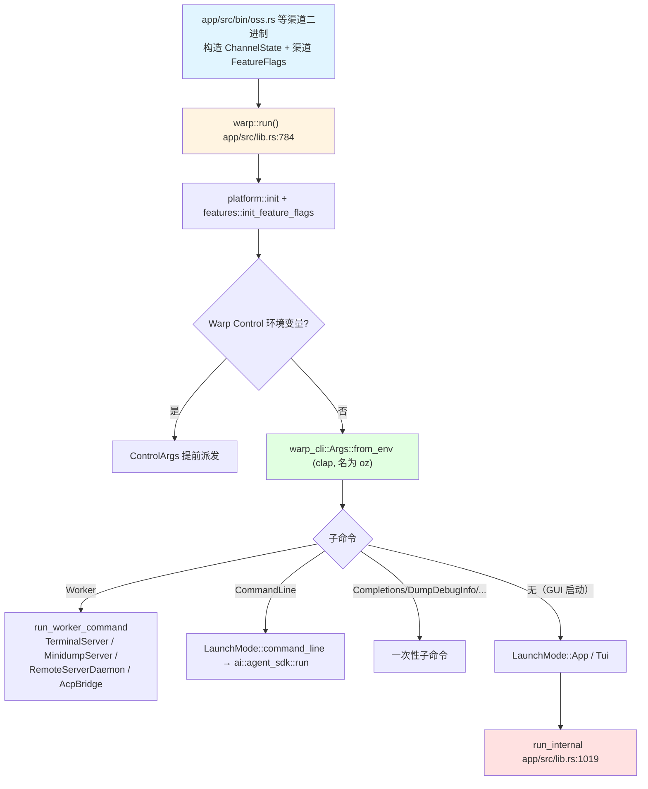
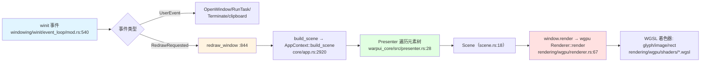
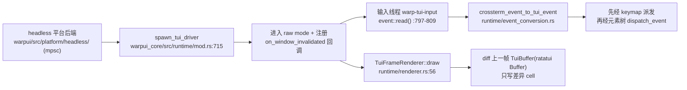
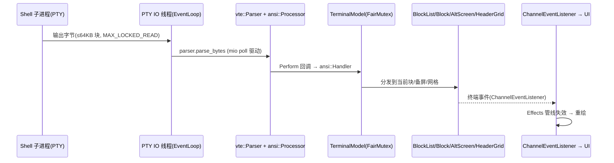
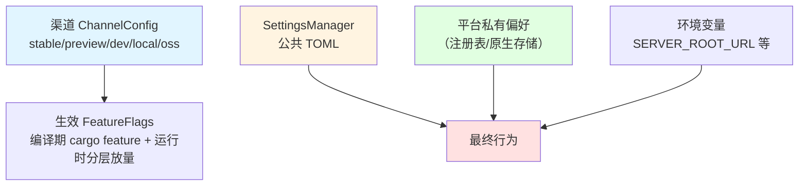
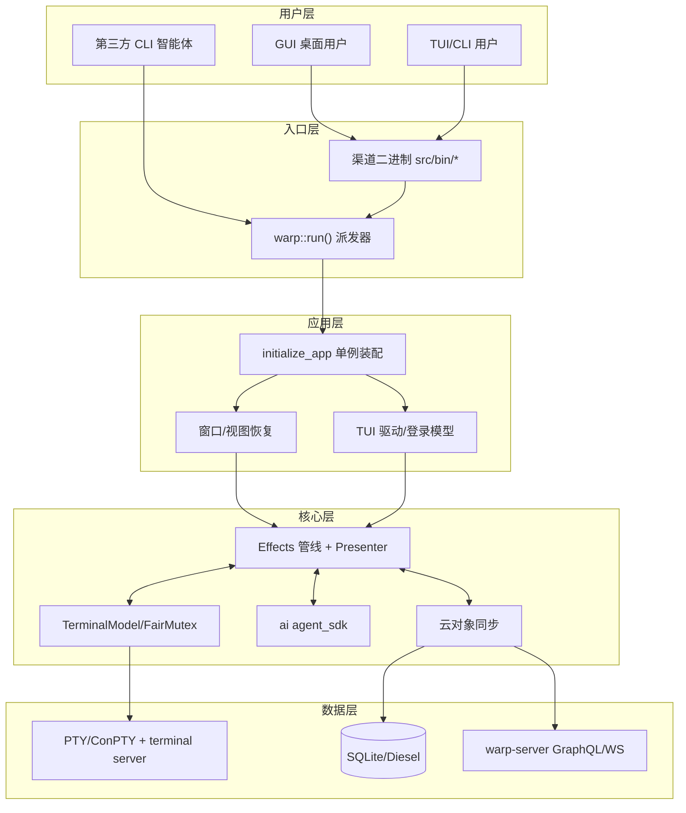

# Warp - 运行机制详解

> 生成时间: 2026-11-17
> 数据来源: 入口/初始化/事件循环/终端模拟路径的源码级追踪（file:line 均相对仓库根）

## 一、项目运行方式

Warp 是一个多入口单体：同一 `warp::run()` 派发器根据 CLI 子命令与编译目标，路由到 GUI 桌面应用、无头 TUI、命令行智能体（`oz`）、后台 worker 乃至 WASM 页面。

### 1. 安装与执行

```bash
./script/bootstrap    # 平台环境准备
./script/run          # = cargo run --bin warp-oss --features gui（GUI 桌面应用）
./script/run-tui      # = cargo build -p warp_tui --bin warp-tui-oss（无头 TUI）
cargo run --bin warp-oss -- --help   # 直接查看 CLI（oz 智能体入口）
```

### 2. 执行流程（入口派发）



要点：

- **渠道二进制**（`app/src/bin/`）：`oss.rs:10-30` 手工构造生产配置（telemetry/crash 均为 None）+ debug 构建 `DEBUG_FLAGS`；`local.rs:5-22` 用 `warp_channel_config::load_config!("local")` 并叠加 DEBUG+DOGFOOD+PREVIEW+LOCAL 标志；`stable/preview/dev` 同构。全部最终调 `warp::run()`。
- **LaunchMode**（`app/src/lib.rs:389-431`）：`App | CommandLine | Test | RemoteServerProxy | RemoteServerDaemon | Tui{TuiEntryPoint}`。
- **TUI 入口**：`crates/warp_tui/src/bin/oss.rs:13-33` → `warp_tui::run()`（`crates/warp_tui/src/session.rs:196`）解析自己的 `TuiArgs`，处理一次性命令（DumpSettingsSchema、GetGitAccessJwt 等）后调 `warp::run_tui(api_key, mount)`（`app/src/lib.rs:976`）→ `run_internal(LaunchMode::Tui)`。
- **WASM**：同一 `run()`，差异分支在 `app/src/lib.rs:1108-1115`（web intent URL 解析）、`3191`（回退字体）、`3246`（web 上 CLI 报错）；无窗口后端 `AppBuilder::new_windowless`（`app/src/lib.rs:1263`）。

## 二、GUI 应用初始化序列

**位置**: `run_internal`（`app/src/lib.rs:1019`）→ `app_builder.run(closure)`（:1348）→ `initialize_app`（:1382，定义于 :1504）

有序步骤：

1. Windows DLL 加载配置（:1029）、profiling/tracing 初始化（:1048）、`warp_logging::init`（:1069，崩溃恢复变体 :1066）
2. Linux/Windows release 包单实例转发（:1128-1181）；Windows Job Object `command::windows::init()`（:1187）
3. `settings::set_settings_mode`（GUI/TUI 二态，:1192）、私有/公共偏好初始化、`CrashRecovery::new`（:1217）、**`PtySpawner::new`**（:1227）
4. `AppCallbacks`（TUI/GUI 分叉 :1232-1255）→ `warpui::platform::AppBuilder::new/new_windowless`（:1256-1268）；平台调优：macOS Dock/菜单（:1277）、Linux X11/Wayland（:1298）、Windows AppUserModelID + DXC 着色器编译器（:1313）
5. closure 内：日志轮转、执行模式、`PtySpawner` 与偏好单例注册，随后 **`initialize_app`**（:1504）：安全存储 → `WarpConfig`/`SettingsManager`/`settings::init` → `AuthState::initialize` → `NetworkLogModel`/IAP/`ServerApiProvider` → `GPUState` → persistence/SQLite（TUI 有独立 DB scope，:1667）→ 云对象/实验恢复 → `ApiKeyManager` → **`crash_reporting::init`（Sentry）** → 实验与几十个单例模型 → 全局 action 注册
6. 分叉：TUI → `app/src/tui/mod.rs:209`（TuiLoginModel、挂载视图、auth 订阅）；GUI → `launch()`（:3179：键位绑定、恢复窗口 `root_view:open_from_restored`、URL 处理、必要时 `root_view:open_new`、登录项注册）；CommandLine → `ai::agent_sdk::run`（:3249）

## 三、事件循环与渲染

### 3.1 GUI：winit + wgpu



- **Effects 管线**（变更传播核心）：任何状态修改压入 `Effect`（`warpui_core/src/core/mod.rs:205-231`：Event / ModelNotification / ViewNotification / Focus / TypedAction / GlobalAction）到 `AppContext.pending_effects`（`core/app.rs:671`），由 `flush_effects` 排干 → `update_windows`（:3512）→ 失效标记 → 重绘。
- 事件循环构造：`crates/warpui/src/windowing/winit/app.rs:156`（`EventLoop::with_user_event()` :169、`init_wgpu_instance` :181）。

### 3.2 TUI：headless 后端 + crossterm



驱动在 `crates/warp_tui/src/session.rs:391`：`ctx.add_tui_window(..., RootTuiView::new)`（:377，`core/app/tui.rs:128`）后逐帧绘制。

## 四、终端模拟与 Shell 会话（核心数据流）

### 4.1 进程派生

- `PtySpawner`（`crates/warp_terminal/src/local_tty/spawner.rs:144,186`）优先经**独立 terminal server 进程**派生（`spawn_pty_via_server` :262；worker 即 `Command::Worker(TerminalServer)`，`app/src/lib.rs:889`），回退直接派生（:243）。
- **非 portable-pty 自研**：Unix 走 `nix::pty::openpty` + fork（`local_tty/unix.rs:20,52`）；Windows 走手写 **ConPTY** 绑定，动态加载 `conpty.dll` 的 `CreatePseudoConsole`（`local_tty/windows/conpty_api.rs:17-57`）。
- 调用方：`app/src/terminal/local_tty/terminal_manager.rs:1296`（`Pty::new(PtyOptions{shell_starter, env_vars,...})`）+ `start_pty_event_loop`（:1306）。

### 4.2 字节流 → 屏幕



- IO 线程：`crates/warp_terminal/src/local_tty/event_loop.rs:44`（Alacritty 衍生，mio poll）；读取在 `Arc<FairMutex<M>>` 下分块（:48，上限 `MAX_LOCKED_READ=0x1_0000` :30）。
- 解析器：`ansi::Processor` 包裹 **vte::Parser**（`crates/warp_terminal/src/model/ansi/mod.rs:31,371,383`）；`Perform` 由 `TerminalModel` 实现（`app/src/terminal/local_tty/mod.rs:25`），委托 `BlockList`/`Block`/`AltScreen`/`HeaderGrid` 的 Handler（`app/src/terminal/model/blocks.rs:3754` 等）与 `GridHandler`（`crates/warp_terminal/src/model/grid/ansi_handler.rs:155`）。
- **锁纪律**（AGENTS.md 反复强调的原因）：`TerminalManager::model()` 返回 `Arc<FairMutex<TerminalModel>>`（`app/src/terminal/terminal_manager.rs:27`）；模型被 PTY 读线程与主线程共享，读取按块限制持锁时长以避免饿死写者——新增 `model.lock()` 前必须确认调用栈上无既有锁。

### 4.3 Blocks 模型

- `TerminalModel.block_list`（`terminal_model.rs:387`）持有 `Block`（`app/src/terminal/model/block.rs:297`；含 `BlockCommand` :490、`PromptInfo` :517、`BlockState` :623）；每块拥有 prompt/output 网格，底座是 `BlockGrid`（`crates/warp_terminal/src/model/blockgrid.rs:30`）。
- **块边界来自 shell 钩子转义序列**：捆绑引导脚本（bash/zsh/fish .sh、pwsh .ps1）注入的 InitShell/precmd/preexec DCS 序列（`crates/warp_terminal/src/bootstrap.rs:54,84,178`）+ 会话 ID（:193）。
- 生命周期状态机：`BlockLifecycleCoordinator`（`app/src/terminal/model/lifecycle/transition.rs`，`LifecycleInput::CommandFinished` 等输入驱动 AwaitingPrecmd 等相位）。
- 渲染：`app/src/terminal/block_list_element.rs`、`blockgrid_renderer.rs`。

## 五、跨切面机制

| 机制 | 位置 | 要点 |
|------|------|------|
| App/Entity/ViewHandle | `warpui_core/src/core/app.rs:76,600`、`core/entity.rs` | `App(Rc<RefCell<AppContext>>)` 全局持有 entity；视图按窗口注册并做失效跟踪 |
| Actions | `core/action.rs:6-28`、`core/app.rs:1589,1730,1400` | 空白 trait 实现（任何 `Any+Debug+Send+Sync`）；typed/global/string 三种派发；keymap 上下文由 `AnyView::keymap_context` 提供 |
| FeatureFlag | `crates/warp_features/src/lib.rs:8,1024,1038-1128` | 枚举 + AtomicBool；DEBUG/LOCAL/DOGFOOD/PREVIEW/RELEASE 分层；渠道选择在 `app/src/features.rs:8-23`；`warp_core::features` 再导出并提供运行时开关菜单 |
| Settings | `crates/settings/src/lib.rs:309-342` 等 | `Setting` trait（toml_path/toml_key）；GUI=TOML 公共存储 vs 平台原生私有存储，由 `set_settings_mode` 切换；schema 可由二进制导出 |
| 遥测/崩溃 | `app/src/tracing.rs:16`、`app/src/crash_reporting/mod.rs:296`、`app/src/server/telemetry/` | OpenTelemetry OTLP 导出；Sentry + minidump server（worker 进程）；产品事件经 TelemetryCollector（Rudder/服务端），TUI 关停时 flush（`app/src/lib.rs:1236`） |

## 六、扩展机制

### 6.1 插件/扩展面

| 扩展点 | 机制 |
|--------|------|
| Workflows | YAML 工作流（warp-workflows 外部 crate），`app/src/workflows/` |
| Skills | 捆绑/用户技能（`resources/bundled/skills`、`.warp/skills`），`crates/ai/src/skills` |
| MCP 服务器 | 用户配置命令（npx 等），`crates/mcp`（SSE 传输 + OAuth） |
| 第三方 CLI 智能体 | Claude Code/Codex/Gemini CLI 经 coding_entrypoints / ACP 接入 |
| Shell 集成 | 捆绑 bootstrap 脚本注入会话钩子（见 §4.3） |

### 6.2 配置层级



## 七、运行时架构总结



## 总结

Warp 的运行机制围绕以下核心概念：

1. **单一派发器**：`warp::run()` + LaunchMode 统一 GUI/TUI/CLI/worker/WASM 五种形态，渠道差异在二进制入口处以 ChannelState+FeatureFlags 装配。
2. **Effects 驱动的 UI**：所有状态变更经 pending_effects 队列 → flush → 窗口失效 → Presenter 重建 Scene → wgpu/WGSL（GUI）或 cell diff（TUI）输出，一套心智模型两种后端。
3. **自研 PTY 栈**：terminal server 进程隔离派生 + nix openpty / 手写 ConPTY，vte 解析，按块限锁的 FairMutex 共享模型。
4. **Blocks 范式**：shell 钩子转义序列划界，命令/输出成块（Block/BlockGrid + 生命周期状态机），是 Warp 区别于传统终端滚屏的根本数据模型。
5. **分层功能开关**：编译期 cargo feature 管依赖与死代码，运行时 FeatureFlag 按渠道分级放量。
6. **单例装配式初始化**：initialize_app 按序注册几十个全局模型（设置→认证→网络→GPU→持久化→Sentry→实验），组合根职责清晰。

这种设计使 Warp 既**能在同一代码库上同时交付 GPU 桌面应用、纯终端 TUI 与 WASM 页面**，又**保持了终端核心的可测试性与平台无关性**，非常适合作为大型 Rust 桌面+CLI 双形态应用的架构参考。
